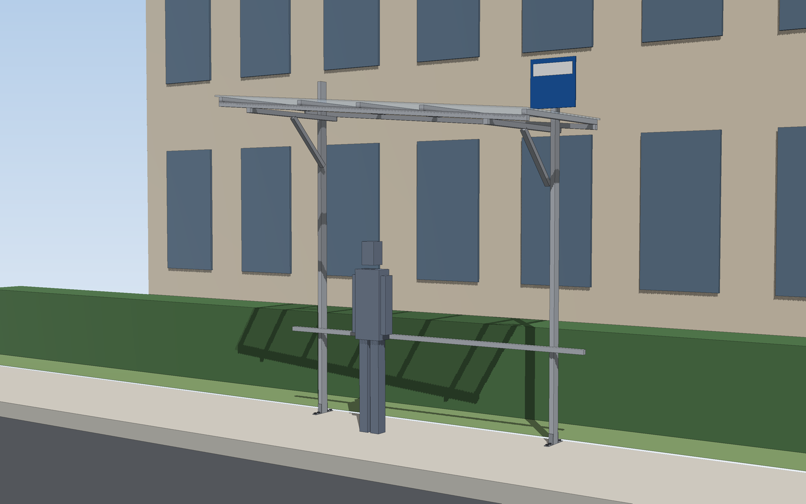

# OBS-10 Open Bus Shelter

An open-source, two-post bus shelter and optional bench, built entirely from off-the-shelf strut channel, fittings and roofing sold at ordinary hardware stores. No welding, no metal cutting, two people with hand tools and one hammer drill.



> **Status: Draft Rev A, for discussion.** Not for construction until a licensed engineer in your jurisdiction has reviewed and stamped the design. See [the engineering review list](docs/engineering-review.md) for what is still open.

## At a glance

| | |
|---|---|
| Footprint | 3048 mm / 10 ft long roof, 1219 mm / 4 ft deep, on two posts set in a 305 mm / 12 in zone at the back of the walk |
| Fits | Sidewalks 1524 mm / 5 ft and wider, keeping a 1219 mm / 4 ft clear path |
| Structure | 41 mm / 1-5/8 in galvanized strut channel in three stock lengths (10, 4 and 2 ft), bolted |
| Roof | Two corrugated polycarbonate panels laid lengthwise, sloped about 1:12 end to end |
| Seating | Leaning rail on narrow sidewalks; hanging 4 ft bench on sidewalks about 7 ft and wider |
| Accessibility | 760 x 1220 mm / 30 x 48 in wheelchair space under the roof, parallel to the curb; 2032 mm / 80 in minimum headroom |
| Anchoring | Surface-mounted to existing concrete with 8 screw anchors (no footings) |
| Materials cost | About US$990 shelter only, about US$1,440 with bench (US retail prices, October 2026, before tax) |

## What's in this repository

| Folder | Contents |
|---|---|
| [`manual/`](manual/) | IKEA-style, mostly wordless assembly manual: [PDF](manual/OBS-10-manual.pdf), page sources (HTML) and illustrations |
| [`drawings/`](drawings/) | Plan, elevation, section and post-base detail: [PDF](drawings/OBS-10-drawings.pdf), PNG previews and HTML sources |
| [`bom/`](bom/) | Generic [parts list](bom/parts-list.csv) (metric and imperial, no brands) and a US cost estimate workbook |
| [`renderings/`](renderings/) | Concept renderings, with and without bench |
| [`docs/`](docs/) | [Design specification](docs/spec.md), [engineering review list](docs/engineering-review.md) and the project website |
| [`src/`](src/) | Python scripts that generate the renderings and manual illustrations from the design dimensions |
| [`tools/`](tools/) | Build script for the PDFs |

## Give feedback

Feedback is what this draft is for. Pick the route that fits:

- **Something specific to fix or check** → [open an issue](../../issues/new/choose). There are forms for structural/engineering, accessibility, parts and sourcing, manual clarity, local adaptations and build reports.
- **Open questions and ideas** → [Discussions](../../discussions).

Engineers reviewing the design: markup on the drawing PDF is welcome. Attach it to a structural issue.

## Build the PDFs yourself

```
pip install pypdf
python tools/build_pdfs.py --png
```

Requires Google Chrome or Chromium. Illustrations regenerate with `python src/ikea_steps.py <out_dir> s01 s02 ...` (needs `numpy` and `pillow`).

## License

- Hardware design (drawings, parts list, dimensions): [CERN-OHL-P-2.0](LICENSE)
- Manual, documentation and images: [CC BY-SA 4.0](LICENSE-DOCS)
- Code in `src/` and `tools/`: CERN-OHL-P-2.0
- IBM Plex fonts in `assets/fonts/`: [SIL Open Font License](assets/fonts/OFL.txt)

Using or adapting this design does not transfer any engineering responsibility. Every installation needs local engineering review and permits.
